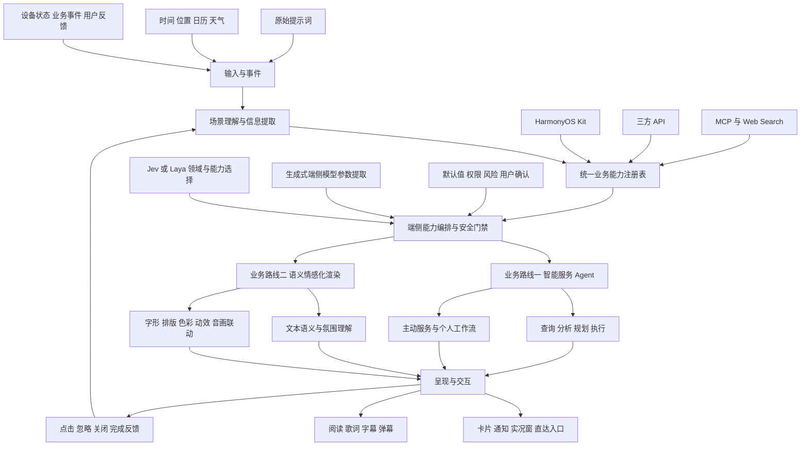

# 智能生成业务全景图

## 一句话定位

将智能生成从“根据业务类型生成 UI 卡片”升级为“在端侧理解用户和场景，安全调用系统及外部能力，并通过合适的界面主动提供服务”。

## 为什么需要升级

当前模式主要解决卡片模板匹配问题，长期存在四个限制：

- 上游已经把原始提示词解析为业务类型，本组缺少用户意图理解能力；
- 模板库是交付结果，但技术门槛和复用价值有限；
- 服务只在用户主动发起请求后出现，无法利用端侧环境和习惯数据；
- 业务数据、决策逻辑和 UI 模板之间缺少稳定的能力契约，扩展一个场景往往需要重复开发。

## 总体架构



## 两条业务路线

### 路线一 智能服务 Agent

这是近期主航道，目标是减少用户寻找应用、理解界面和重复操作的成本。

#### 服务直达

- 将底层 API、组件和服务流程转换为稳定的业务能力；
- 屏蔽设备版本、权限、生命周期和服务端差异；
- 从系统 Kit 逐步扩展到三方 API、MCP 和 Web Search；
- 在用户确认后完成查询、规划、写入、分享和支付等动作。

#### 主动服务

- **日常刚需预判**：天气、通勤、日程、票券、快递和订单状态；
- **关键旅程编排**：会议、差旅、运动、酒店入住和活动入场；
- **低打扰呈现**：只在价值超过打扰成本时，通过通知、实况窗或卡片出现；
- **持续学习**：根据点击、忽略和关闭反馈调整场景、时间和频率。

#### 个人工作流

系统识别用户反复执行的操作，在用户确认后将其沉淀为可查看、可编辑、可关闭的个人工作流。例如：

```text
工作日 07:40
  → 查询天气
  → 查询第一场日程
  → 计算到公司的路线
  → 准备乘车服务入口
  → 仅在需要提前出发或天气异常时提醒
```

个人工作流不是让模型自动记录一切，而是把明确、重复、可解释的操作模式转化为用户可管理的服务。

### 路线二 语义情感化渲染

这是差异化探索方向。目标不是简单增加动画，而是把内容语义转换为可控的视觉表达。

#### 情感输入

- 文本主题、情绪类别、强度和转折；
- 关键词、人物、事件和叙事节奏；
- 音频节拍、语音强弱、画面氛围和场景类型；
- 用户主动选择的阅读或表现偏好。

#### 情感输出

- 字体、字号、字重、颜色和留白；
- 字形结构拆解与关键词字级效果；
- 段落、字幕和歌词的节奏化动效；
- 音频、画面、文字和触觉的联动；
- 不同媒介下的渲染强度控制和无障碍降级。

#### 重点场景

- 阅读中的重点句和情绪转折；
- 音乐歌词的节奏与情绪表达；
- 视频字幕和弹幕的语义强调；
- 服务卡片和通知中的状态氛围表达。

## 公共技术底座

| 底座能力 | 解决的问题 | 主要产物 |
|---|---|---|
| 场景理解 | 从提示词和上下文中得到领域、意图、参数和限制 | 结构化场景对象 |
| 能力生成 | 将复杂 API 转换为模型可用的业务能力 | 能力清单、适配器、Schema、测试 |
| 端侧编排 | 用低时延模型选择能力和提取参数 | 能力选择器、参数解析器、执行计划 |
| 安全治理 | 防止越权、误支付、误发送和隐私泄露 | 权限策略、风险分级、确认流程、审计 |
| 呈现引擎 | 将服务结果或语义参数转换为 UI | 卡片、通知、实况窗、渲染参数 |
| 反馈学习 | 判断主动服务是否真正有用 | 行为事件、频控策略、个人偏好 |

## 业务能力与 HarmonyOS Kit 的对应关系

| 业务能力 | 关键 Kit | 作用 |
|---|---|---|
| 时间和日程 | Calendar | 提供未来事件、地点和提醒 |
| 位置和场景触发 | Location | 当前地点、地理编码、围栏事件 |
| 天气环境 | Weather Service | 实况、预报、预警和生活指数 |
| 地点和路线 | Map | 地点搜索、坐标解析、路线规划和导航入口 |
| 健康状态 | Health Service | 运动、睡眠和健康记录，需授权 |
| 行程和凭证 | Wallet | 出行凭证、门票、房卡和合作方交通卡 |
| 业务事件 | Push | 订单、行程和服务状态变化 |
| 主动呈现 | Notification、Live View | 通知、动作按钮和持续状态展示 |
| 场景化交互 | Scenario Fusion、App Linking | 功能按钮、智能填充和直达入口 |
| 文件和资料 | Cloud、File Manager、PDF、Preview | 文件获取、预取、预览和阅读 |
| 高风险执行 | Payment、IAP、Share、Call、Account | 用户确认后的支付、购买、分享、通话和登录 |

## 产品原则

1. **价值大于打扰**：主动服务需要同时满足相关性、时效性和可操作性。
2. **模型负责理解**：模型不直接绕开权限、前台界面和用户确认。
3. **端侧优先**：敏感数据尽量不离开设备，输入字段保持最小化。
4. **结果可解释**：告诉用户为什么出现这项服务以及使用了哪些数据。
5. **用户可管理**：允许关闭场景、调整频率、清除习惯和撤销授权。
6. **能力可扩展**：系统 Kit、三方 API、MCP 和 Web Search 使用统一能力契约。
7. **广告不参与决策**：主动服务的排序以用户价值为目标，不被第三方商业推荐污染。

## 近期优先级

| 优先级 | 工作 | 原因 |
|---:|---|---|
| P0 | 天气提示词到业务数据 PoC | 范围清晰，可快速验证端侧路由、参数提取和 API 编排 |
| P0 | 统一业务能力 Schema 和运行时门禁 | 后续所有场景共同依赖 |
| P1 | 通勤出发助手 | 能同时验证天气、位置、日历、地图和主动呈现 |
| P1 | 会议准备助手 | 能验证资料、联系人和跨 Kit 编排 |
| P2 | 个人工作流学习 | 需要先积累真实反馈数据 |
| P2 | 三方 API、MCP 和 Web Search 接入 | 验证能力层的开放性 |
| P3 | 语义情感化渲染 PoC | 作为差异化探索，避免分散主线资源 |

## 判断方向是否成功的指标

不再以模板数量或底层 API 包装数量作为核心指标。建议关注：

- 用户请求的端到端任务完成率；
- 领域识别、能力选择和参数提取准确率；
- 新业务能力的平均接入周期；
- 一个能力被多少场景复用；
- 端侧决策和首屏结果时延；
- 未经确认的高风险动作数量，目标必须为零；
- 主动服务点击率、完成率、关闭率和同类屏蔽率；
- 用户关闭权限、关闭通知和清除习惯的比例。

