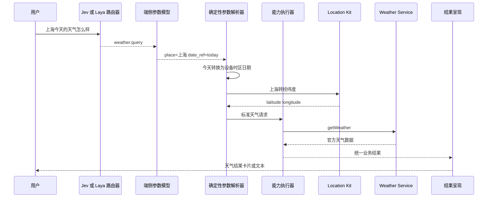

# 天气场景端侧智能调用 PoC 技术方案

## 一 PoC 要证明什么

天气 PoC 的目标是证明：在不把完整官方 API 文档交给运行时大模型的情况下，端侧模型可以把用户原始提示词稳定转换为业务数据请求。

需要验证的核心链路是：

```text
原始提示词
  → 识别天气领域
  → 选择天气查询能力
  → 提取地点 时间和数据需求
  → 补全用户未说明的参数
  → 将地点转换为经纬度
  → 调用 Weather Service
  → 返回统一天气数据
```

### PoC 成功标准

PoC 成功不等于“能回答一次上海天气”。它需要同时证明：

- 不同表达方式都能稳定选择天气能力；
- 地点、相对时间和天气需求可以正确解析；
- 缺省地点和日期能按明确规则补全；
- 城市名可以转换为天气 API 所需坐标；
- 权限、网络、歧义和无结果情况可控；
- 输出是稳定业务数据，不依赖模型临时拼接；
- 端侧路由和参数提取相较全量生成方案具有时延优势。

## 二 非目标

第一版明确不做以下工作：

- 不做全量 28 个 Kit 的能力生成；
- 不做真正的用户行为预测；
- 不做天气知识问答或气象学解释；
- 不让模型直接生成 ArkTS 调用代码并执行；
- 不支持自动安装未知三方天气应用；
- 不以 UI 精美程度作为技术链路是否成立的判断依据；
- 不在第一版训练长期用户偏好模型。

这些能力可以在天气链路稳定后逐步加入。

## 三 官方能力基础

Weather Service 的核心查询接口接收天气请求并返回相应数据。天气请求需要位置参数，可以选择实况、逐日、逐小时、分钟级、预警、指数、潮汐和城市信息等数据集。

用户说“上海今天的天气”时，提示词中的“上海”不是 Weather Service 可直接使用的最终参数。建议先调用 Location Kit 的地理编码能力，将地点名称转换为经纬度，再调用 Weather Service。

官方资料：

- [Weather Service Kit API](https://developer.huawei.com/consumer/cn/doc/doccenter-references/api/weather-service-api)
- [weatherService API](https://developer.huawei.com/consumer/cn/doc/doccenter-references/api/weather-service-weatherservice)
- [获取指定城市天气的官方说明](https://developer.huawei.com/consumer/cn/doc/harmonyos-guides-V5/weather-service-faq-1-V5)
- [Location Kit API](https://developer.huawei.com/consumer/cn/doc/doccenter-references/api/location-api)

## 四 总体架构



## 五 模块职责

### 1 能力注册表

运行时模型不读取完整官方 API 列表，只读取经过开发阶段生成和审核的业务能力。

天气 PoC 至少需要三个能力：

| 能力 ID | 作用 | 是否直接暴露给路由器 |
|---|---|:---:|
| `weather.query` | 查询指定地点和时间范围的天气 | 是 |
| `location.resolve_place` | 将地点名称转换为候选坐标 | 否，作为内部步骤 |
| `location.current` | 获取用户当前坐标 | 否，作为默认参数来源 |

`weather.query` 对路由器表现为一个完整业务动作，内部可以组合 Location 和 Weather 两个 Kit。

建议的能力描述：

```yaml
capability_id: weather.query
domain: weather
description: 查询指定地点的当前天气 预报 预警或生活指数

inputs:
  place_text:
    type: string
    required: false
  date_range:
    type: local_date_range
    required: false
  data_needs:
    type: enum_array
    values: [current, hourly, daily, alerts, indices, minute, tides]
    required: false

defaults:
  place_text: current_location
  date_range: today
  data_needs: [current, daily]

risk:
  level: read_only
  confirmation: none

execution:
  - resolve_place_or_current_location
  - map_data_needs_to_weather_datasets
  - weather_service_get_weather
```

### 2 Jev 或 Laya 类路由器

路由器只承担两个判断：

1. 是否属于天气领域；
2. 在天气领域中选择哪个业务能力。

首版候选能力可以只有：

- `weather.query`；
- `weather.unsupported`；
- `none`。

路由器不解析经纬度，不调用 API，也不生成自由文本。输出示例：

```json
{
  "choice": "weather.query",
  "score": 0.98
}
```

当置信度低于阈值时返回 `none`，由上层决定澄清或进入其他领域。不要为了提高覆盖率强制选择天气能力。

### 3 生成式端侧参数模型

参数模型只看到：

- 原始提示词；
- 已选择能力的参数 Schema；
- 少量正反例；
- 当前设备语言和时区。

模型不需要看到 Weather Service 的类名、Context、错误码和数据结构。

示例输入：

```text
用户：明早去杭州要不要带伞
能力：weather.query
参数：place_text date_range data_needs
```

期望输出：

```json
{
  "place_text": "杭州",
  "date_range": {
    "reference": "tomorrow_morning"
  },
  "data_needs": ["hourly", "alerts"]
}
```

模型只能提取用户显式表达的信息。用户没有说地点时，模型应省略地点字段，而不是猜测城市。

### 4 确定性参数解析器

确定性代码负责把模型输出转换为可执行参数。

#### 时间解析

- “今天”使用设备当前时区的本地日期；
- “明早”转换为下一自然日和预设早间时间窗；
- “周末”需要根据当前星期得到最近的周六和周日；
- 超出 Weather Service 可查询范围时返回明确错误；
- 模型输出的日期与原始提示词冲突时，不执行并记录解析错误。

#### 地点解析

- 用户明确地点：调用地点名称到坐标的解析能力；
- 用户未明确地点且已授权位置：使用当前位置；
- 用户未明确地点且无位置权限：询问用户地点，不自动弹权限；
- 返回多个高相似候选：要求用户选择，例如“朝阳”可能指北京朝阳区或辽宁朝阳市；
- 解析不到地点：返回可理解错误，不把地点字符串直接传给天气 API。

#### 数据集选择

| 用户表达 | Weather 数据需求 |
|---|---|
| “现在多少度” | current |
| “今天怎么样” | current、daily |
| “下午会下雨吗” | hourly、minute，可用时加入 alerts |
| “未来一周” | daily |
| “有没有天气预警” | alerts |
| “适合跑步吗” | current、hourly、indices |
| “潮汐怎么样” | tides |

这个映射应由规则和配置表实现，模型可以给建议，但最终映射不由模型自由生成。

### 5 能力执行器

能力执行器负责：

- 检查设备和系统版本；
- 检查网络和必要权限；
- 调用地点解析；
- 调用 Weather Service；
- 将官方错误码转换为统一错误；
- 做超时、重试、缓存和日志脱敏；
- 输出统一业务数据。

统一输出示例：

```json
{
  "status": "success",
  "request": {
    "place_display_name": "上海市",
    "date_range": ["2026-10-10", "2026-10-10"],
    "timezone": "Asia/Shanghai"
  },
  "current": {
    "temperature_c": 23,
    "condition": "cloudy"
  },
  "hourly": [],
  "daily": [],
  "alerts": [],
  "source": "harmonyos_weather_service",
  "observed_at": "2026-10-10T08:20:00+08:00"
}
```

注意：示例数值只用于说明 Schema，不能写入测试期望或演示结果。

### 6 结果呈现

第一版只需支持文本和一个简单卡片：

- 地点和数据更新时间；
- 当前温度和天气状况；
- 与用户问题直接相关的结论；
- 必要的小时或逐日信息；
- 预警和数据来源；
- 权限、网络或歧义时的下一步操作。

不要在第一版投入复杂模板自演进。PoC 的核心是业务数据是否正确、快且可解释。

## 六 关键流程示例

### 示例一 上海今天的天气怎么样

1. 路由器选择 `weather.query`。
2. 参数模型得到 `place_text=上海`、`date_range=today`。
3. 时间解析器将 `today` 转为设备时区日期。
4. 地点解析器把上海转换为经纬度。
5. 执行器请求 current 和 daily 数据集。
6. 返回统一天气对象并生成卡片。

### 示例二 今天会下雨吗

1. 参数模型不输出地点，只输出 `today` 和降水需求。
2. 默认参数解析器检查位置权限。
3. 已授权时使用当前位置；未授权时询问地点。
4. 请求 current、hourly、minute 和 alerts 中设备版本支持的数据。

### 示例三 明早去杭州要不要带伞

1. 抽取杭州和明早。
2. 将明早解析为具体日期和时间窗。
3. 查询对应小时降水概率和预警。
4. 确定性规则根据降水信息生成“建议带伞”或“暂无明显降雨”的业务结论。
5. 大模型可以润色表达，但不能修改天气数值和规则结论。

### 示例四 朝阳后天的天气

1. 地点解析返回多个可信候选。
2. 不直接选择最高分候选。
3. 返回“你指北京朝阳区还是辽宁朝阳市？”
4. 用户选择后继续原执行计划。

## 七 异常和降级策略

| 场景 | 处理方式 |
|---|---|
| 路由置信度不足 | 不调用天气 API，进入澄清或其他领域 |
| 参数模型输出非法 JSON | 使用一次约束修复；仍失败则返回解析失败 |
| 未提供地点且没有定位权限 | 询问地点，不强制申请权限 |
| 城市名称存在歧义 | 返回候选供用户选择 |
| 地点无法解析 | 建议用户补充城市、省份或国家 |
| Weather Service 不可用 | 明确说明暂时无法获取，不生成虚构天气 |
| 网络不可用 | 可展示带时间戳的短期缓存，否则说明离线 |
| 请求超时 | 有限重试一次，之后返回超时和重试入口 |
| 系统版本不支持 | 返回设备不支持，并考虑三方天气能力作为后续扩展 |
| 用户同时问多个领域 | 第一版拆成天气任务和未支持任务，不混合执行 |

## 八 测试集设计

建议第一版建设不少于 300 条人工审核测试语料，并保留扩充机制。

| 类型 | 建议数量 | 示例 |
|---|---:|---|
| 明确地点和日期 | 60 | 上海今天的天气 |
| 相对时间 | 50 | 明早 后天下午 周末 下周一 |
| 缺省地点 | 40 | 今天会不会下雨 |
| 天气需求表达 | 50 | 带伞 穿什么 适合跑步 空气情况 预警 |
| 地点歧义 | 30 | 朝阳 长安 河口 |
| 口语和错别字 | 30 | 魔都今天天咋样 杭洲明天冷不冷 |
| 非天气与拒识 | 25 | 帮我创建日程 播放音乐 |
| 权限 网络和版本异常 | 15 | 无定位权限 离线 服务不可用 |

测试数据需要标注：领域、能力、显式参数、默认参数策略、候选地点、预期数据集和是否应澄清。

真实天气数值随时间变化，不应用固定温度作为长期回归测试。API 合约测试应验证字段、类型、时间戳、错误处理和合理范围。

## 九 验收指标

以下数字是 PoC 目标，需要通过测试得到，不是当前结论。

| 层级 | 指标 | 目标 |
|---|---|---:|
| 路由 | 天气领域识别准确率 | 不低于 97% |
| 路由 | 错误调用天气能力的比例 | 不高于 1% |
| 参数 | 地点字段完全正确率 | 不低于 97% |
| 参数 | 相对时间解析正确率 | 不低于 98% |
| 参数 | 核心字段整体完全匹配率 | 不低于 95% |
| 执行 | 条件满足时端到端成功率 | 不低于 95% |
| 安全 | 无地点时凭空猜测城市 | 0 次 |
| 可靠性 | API 失败后虚构结果 | 0 次 |
| 时延 | 路由加参数解析 P50 | 目标设备数百毫秒级，最终以实测为准 |
| 时延 | 端到端 P95 | 分解模型和网络耗时后设定设备目标 |

除了平均值，还要按设备、模型大小、提示词长度、权限状态和网络状态分别统计。

## 十 技术对照实验

至少比较三种方案：

| 方案 | 描述 | 目的 |
|---|---|---|
| A 全生成模型 | 一个生成式模型完成领域、API 和参数 | 作为基线 |
| B Jev 或 Laya 加生成参数模型 | 判别模型选能力，生成模型提参数 | 验证建议架构 |
| C 规则加生成参数模型 | 关键词和规则选天气，模型提参数 | 判断天气单场景是否根本不需要判别模型 |

比较准确率、模型大小、token、P50/P95 时延、能耗、拒识能力和调试成本。即使方案 C 在单一天气场景更快，也不代表多领域扩展后仍然最好，因此需要记录候选能力数量变化带来的影响。

## 十一 开发任务拆分

### 工作流 A 能力定义和 Codex 生成

- 完成 `weather.query` 能力 Schema；
- 生成 Location 和 Weather 适配器骨架；
- 生成错误映射、Mock 和单元测试；
- 建立官方文档版本记录；
- 人工审核权限、版本和调用流程。

### 工作流 B 端侧模型

- 选定 Jev 或 Laya 运行版本和目标设备；
- 建立领域与能力选择数据；
- 设计参数提取 Schema 和少样本提示；
- 测量模型包大小、内存、首 token 和完整输出时延；
- 实现置信度阈值和拒识。

### 工作流 C 运行时和执行

- 实现能力注册、参数校验和执行计划；
- 实现时间与地点默认值解析；
- 实现权限、网络和系统版本检查；
- 实现超时、缓存、统一错误和脱敏日志；
- 接入真实设备 API。

### 工作流 D 评测和体验

- 建设测试集和自动评测；
- 建立三种方案的对照实验；
- 实现简单结果卡片；
- 组织真机回归和异常测试；
- 形成评测报告和是否进入下一阶段的建议。

## 十二 六周建议计划

| 周次 | 工作 | 当周可见结果 |
|---:|---|---|
| 第 1 周 | 明确能力 Schema、取得官方 API 最小调用、建立 50 条测试集 | 固定地点天气查询跑通 |
| 第 2 周 | 接入领域路由和参数模型，完成时间解析 | “上海今天”端到端跑通 |
| 第 3 周 | 接入地理编码、当前位置默认值和权限处理 | 显式地点与默认地点均可运行 |
| 第 4 周 | 完成异常降级、统一数据结构和简单卡片 | 可演示的完整 PoC |
| 第 5 周 | 扩充到 300 条测试集，开展三方案对照 | 第一版量化结果 |
| 第 6 周 | 真机性能、能耗和稳定性测试，评审是否扩展 | PoC 结论和下一阶段决定 |

## 十三 阶段结束需要回答的问题

1. 分层架构是否比单一生成模型更准、更快或更容易治理？
2. Jev 或 Laya 在候选能力扩展时是否仍然稳定？
3. 参数模型最容易出错的是地点、时间还是天气需求？
4. 默认参数解析能否完全由确定性代码处理？
5. Codex 生成适配器和测试实际节省了多少接入时间？
6. 真机端到端时延中，模型、地理编码和网络各占多少？
7. 权限不足和地点歧义时的交互是否可接受？
8. 是否已经具备加入 Calendar、Map 和 Notification 的基础？

只有这些问题得到量化答案，天气 PoC 才完成了它的任务。

