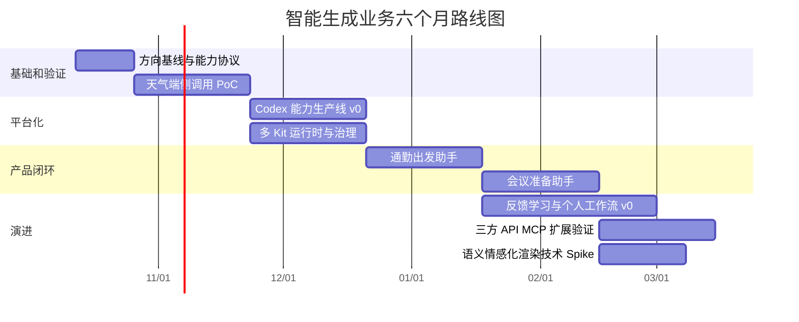

# 智能生成业务六个月路线图

## 路线图目标

六个月内完成从“单场景技术验证”到“可复用能力平台和两个主动服务场景”的跨越，同时为三方能力扩展和语义情感化渲染保留验证入口。

这不是承诺六个月完成通用智能助手。计划重点是建立可验证、可复用、可停止的阶段成果。

## 总体阶段



具体日期可根据正式启动时间整体平移。阶段顺序和退出条件比日历日期更重要。

## 阶段零 方向基线和能力协议

### 时间

第 1 至第 2 周。

### 目标

建立后续所有场景共用的技术和产品契约，避免不同成员各自定义“能力”“场景”和“主动服务”。

### 主要工作

- 确认智能服务 Agent 为近期主线，语义情感化渲染为探索线；
- 定义能力注册表 Schema；
- 定义提示词模式和主动模式的统一场景对象；
- 定义 L0 至 L4 风险等级和确认策略；
- 选择首批目标设备与系统版本；
- 确认 Jev 或 Laya 和生成式端侧模型的候选版本；
- 建立评测仓库、测试集格式和指标计算方式；
- 完成 Weather、Location、Map、Calendar 和 Notification 的第一版能力清单。

### 交付件

- 《统一业务能力协议 v0.1》；
- 《端侧模型分工与输入输出协议》；
- 《权限和动作风险分级》；
- 天气 PoC 任务拆解；
- 50 条种子测试语料；
- 一次运行在目标设备上的官方天气 API 最小调用。

### 退出条件

- 团队能够用同一份 Schema 描述天气和日历能力；
- 运行时模型不再接触原始 SDK API 列表；
- 风险动作与只读动作有明确区别；
- 天气官方 API 在目标设备上真实可用。

## 阶段一 天气端侧调用 PoC

### 时间

第 3 至第 6 周。

### 目标

验证原始提示词到天气业务数据的完整链路，得到准确率、时延和工程复杂度的量化结论。

### 主要工作

- 接入 Jev 或 Laya 类领域和能力选择器；
- 接入生成式端侧参数模型；
- 实现地点、时间和天气数据需求解析；
- 接入 Location 地理编码和当前位置；
- 接入 Weather Service；
- 建立统一结果、缓存和错误模型；
- 建设 300 条以上测试集；
- 比较全生成、分层模型和规则路由三种方案；
- 完成简单结果卡片。

### 交付件

- 可在真机演示的天气 PoC；
- 路由、参数和端到端评测报告；
- 时延、内存和能耗基线；
- Weather 与 Location 能力适配器；
- 可复用的能力注册和执行框架 v0；
- 是否进入多 Kit 主动场景的评审结论。

### 退出条件

- 核心能力选择准确率达到预设目标；
- 地点和相对时间达到可接受准确率；
- API 失败时不生成虚假结果；
- 未提供地点时不会凭空猜测；
- 运行时结构可以在不修改模型主流程的情况下增加第二个领域。

### 停止或调整条件

- 端侧模型在目标设备无法达到基本时延或内存要求；
- 官方天气能力在实际产品设备上不可用；
- 参数错误主要来自不可修复的模型能力，而不是数据和 Schema；
- 分层架构相对规则或单模型方案没有任何可测收益。

若触发停止条件，应先调整模型、能力粒度或设备范围，不直接扩大到更多 Kit。

## 阶段二 Codex 能力生产线和多 Kit 运行时

### 时间

第 7 至第 10 周。

### 目标

把天气阶段的手工适配升级为可复用的能力生产流程，并验证增加 Calendar、Map 和 Notification 时不会线性增加运行时模型复杂度。

### Codex 能力生产线 v0

开发阶段输入：

- 官方 API 根目录和具体页面；
- SDK 类型声明；
- 示例代码和错误码；
- 业务场景说明；
- 公司内部权限和编码规范。

生成产物：

- 能力描述和 JSON Schema；
- ArkTS 或服务端适配器骨架；
- 版本和设备能力检查；
- 权限和风险标签；
- 统一错误映射；
- Mock、单元测试和契约测试；
- 文档版本与生成记录。

人工审核重点：

- 权限和上架政策；
- 组件和前台交互是否可以跳过；
- 高风险动作的确认要求；
- 设备、地区和合作伙伴限制；
- 官方示例与生成代码是否语义一致。

### 多 Kit 运行时 v0

首批领域：

- 天气；
- 日历；
- 位置；
- 地图；
- 通知。

首批业务能力建议控制在 10 至 15 个，不追求底层方法全覆盖。

### 交付件

- 能力生成脚本或工作流 v0；
- 能力注册表和版本机制；
- 五个 Kit 的核心业务能力；
- 权限、设备版本和风险门禁；
- 跨领域路由评测集；
- 新能力接入操作说明。

### 退出条件

- 一个新只读能力可以在 1 至 3 个工作日内完成生成、审核、测试和注册；
- 新增能力不需要重写路由和参数框架；
- 能力版本变化可以被发现并回归；
- 运行时可以准确区分天气、日历和地图等相邻领域。

## 阶段三 通勤出发助手

### 时间

第 11 至第 14 周。

### 目标

用第一个主动服务场景证明：能力平台不仅能回答提示词，还能基于事件和上下文在合适时间准备服务。

### 最小场景

```text
工作日早间或离家围栏事件
  → 查询下一条工作日程
  → 判断目的地和开始时间
  → 查询当前位置和路线
  → 查询沿途和目的地天气
  → 计算是否需要提前出发
  → 通过通知或实况窗提供结果
```

第一版不依赖地铁二维码接口。可以提供由用户配置的乘车服务深链；没有深链时只显示路线和天气，不伪造服务能力。

### 产品规则

- 没有异常天气、路线变化或时间压力时可以不提醒；
- 每张主动服务都说明触发原因；
- 用户可关闭该场景或调整工作日、时间和目的地；
- 不读取其他应用通知作为默认输入；
- 不用高频后台轮询实现；
- 用户忽略或关闭后降低同类触达频率。

### 交付件

- 通勤场景配置页；
- 事件和上下文归一化模块；
- 候选服务生成和价值评分；
- 通知或实况窗呈现；
- 点击、忽略、关闭和完成反馈；
- 小范围真实使用报告。

### 退出条件

- 场景能够通过时间、日历、围栏或 Push 等事件触发；
- 主动服务不依赖持续后台运行；
- 用户能够理解为什么收到提醒；
- 负反馈能影响后续频率；
- 核心链路在目标设备上稳定运行。

## 阶段四 会议准备助手和反馈学习

### 时间

第 15 至第 18 周。

### 目标

验证同一平台能否复用到第二个高价值场景，并开始建立个人偏好，而不是为通勤写一套特例代码。

### 会议准备场景

- 根据 Calendar 得到会议时间、地点和入口；
- 根据 Location 和 Map 判断到达时间；
- 根据 Cloud、PDF 和 Preview 准备资料；
- 根据 Contacts 准备参会人信息；
- 通过通知或卡片展示路线、资料和会议入口；
- 打开资料和会议链接可以直达，分享和拨号仍需确认。

### 反馈学习 v0

只学习明确、低风险的偏好：

- 某类场景是否需要提醒；
- 提前多少分钟最合适；
- 偏好通知、卡片还是实况窗；
- 哪些目的地属于家、公司和常去地点；
- 用户是否总会执行同一组操作。

第一版不训练复杂长期模型，可以使用带衰减的统计、规则和轻量排序器。

### 交付件

- 第二个主动服务场景；
- 场景间共享能力分析；
- 用户反馈事件协议；
- 频控和个性化排序 v0；
- 主动服务质量仪表盘或离线分析报告；
- 个人工作流候选发现原型。

### 退出条件

- 通勤和会议复用同一能力注册、路由、参数和门禁框架；
- 个性化策略能根据反馈降低无效触达；
- 用户可以查看、修改和删除偏好；
- 个人工作流候选必须由用户确认后启用。

## 阶段五 开放能力扩展和差异化探索

### 时间

第 19 至第 24 周。

### 目标

验证平台能否超出系统 Kit，同时控制主线风险。

### 三方 API 与 MCP

优先选择一个系统 Kit 无法提供、但对现有场景有直接价值的能力，例如：

- 交通运营方乘车码或车辆到站信息；
- 企业内部会议、工单或知识服务；
- 物流或订单状态；
- Web Search 的公开实时信息。

接入后必须复用同一能力 Schema、风险门禁和评测体系。若三方能力必须单独为模型写特例，说明能力协议还不够稳定。

### Wallet 等生态能力

若已具备合作条件，可以验证出行凭证、活动门票、酒店房卡或 NFC 交通卡。没有合作条件时，不把它作为六个月路线图的硬性交付。

### 语义情感化渲染 Spike

用一个小范围场景验证技术差异，不同时铺开阅读、歌词、字幕和弹幕。

建议优先选择歌词或字幕：

1. 端侧模型输出情绪、强度、关键词和节奏参数；
2. 确定性渲染引擎将参数映射为字形、颜色、布局和动效；
3. 建立无效果、普通效果和语义驱动效果的对照；
4. 由设计评审和用户实验共同判断价值；
5. 明确哪些评价可以自动化，哪些仍需要人工审美判断。

该 Spike 不应影响 Agent 主线交付。

### 交付件

- 一个三方 API 或 MCP 能力；
- 外部能力接入规范；
- 生态能力的准入条件清单；
- 一份情感化渲染技术验证结果；
- 下一周期业务选择建议。

## 五条并行工作流

| 工作流 | 持续责任 | 六个月核心产物 |
|---|---|---|
| 能力平台 | 文档解析、能力 Schema、适配器、版本、测试 | Codex 能力生产线和能力注册表 |
| 端侧智能 | 领域路由、能力选择、参数提取、个性化排序 | Jev 或 Laya 与生成式 SLM 组合方案 |
| 系统运行时 | 权限、默认值、执行计划、缓存、错误和后台触发 | 安全可控的能力执行引擎 |
| 体验与产品 | 场景定义、通知、卡片、实况窗、频控和解释 | 天气、通勤、会议三个可体验结果 |
| 评测与质量 | 测试集、真机性能、回归、安全和用户反馈 | 可持续的评测基线和阶段报告 |

## 团队规模适配

### 最小配置

至少覆盖以下四种责任，可以一人承担多个角色：

- 能力平台和 API 适配；
- 端侧模型和评测；
- 系统运行时和权限；
- 产品体验和 UI。

测试、设计和隐私安全需要固定接口人参与阶段评审。

### 资源不足时的取舍

按以下顺序削减：

1. 延后情感化渲染；
2. 延后三方 API 与 MCP；
3. 会议助手只保留日历、路线和会议入口；
4. 个性化先做规则与频控，不训练模型；
5. 保留天气 PoC、能力协议和通勤闭环，不削减评测和安全门禁。

## 团队运行机制

### 每周节奏

| 时间 | 活动 | 内容 |
|---|---|---|
| 周一 | 场景和指标确认 | 本周要改善的用例、指标和阻塞 |
| 周三 | 能力与风险评审 | 新能力 Schema、权限、版本和高风险动作 |
| 周五 | 真机演示和数据回顾 | 只展示实际运行结果，同时查看失败案例 |

### 每阶段评审材料

- 实际可运行演示；
- 指标和测试集覆盖；
- 失败案例分类；
- 权限、设备和合作条件；
- 新增技术债务；
- 是否进入下一阶段的明确建议。

## 关键指标体系

### 技术正确性

- 领域识别准确率；
- 能力选择准确率和拒识率；
- 参数完全匹配率；
- 端到端任务成功率；
- 未经确认的高风险动作数量；
- API 变化发现和回归时间。

### 平台效率

- 新能力从文档到可运行的周期；
- Codex 生成代码的人工修改比例；
- 每个能力被复用的场景数；
- 自动生成测试覆盖的接口比例；
- 版本升级适配耗时。

### 用户价值

- 主动服务展示后的点击和完成率；
- 忽略、关闭和同类屏蔽率；
- 每用户每日主动触达次数；
- 用户主动保留的个人工作流数量；
- 因权限或信任问题退出的比例。

## 主要风险和前置应对

| 风险 | 早期信号 | 应对 |
|---|---|---|
| 方向过宽 | 同时启动多个场景但没有可运行闭环 | 以天气和通勤为唯一 P0，其他进入候选池 |
| 只做接口包装 | API 数量增加但场景无法复用 | 以业务能力和任务完成率验收 |
| 模型不可控 | 高置信度错误选择或参数幻觉 | 拒识、Schema 校验、默认值确定性解析 |
| 后台不可用 | 依赖常驻进程或高频轮询 | 围栏、日历、Push 等事件驱动优先 |
| 主动服务扰民 | 忽略、关闭和通知权限关闭上升 | 频控、解释、负反馈学习和场景开关 |
| 生态能力被卡 | Wallet、支付或三方 API 无合作资质 | 不作为早期关键路径，准备深链替代 |
| UI 评审阻塞 | 研发完成但视觉无法验收 | PoC 先验业务正确性，产品阶段再设渲染规范 |
| 情感渲染抢资源 | 探索线影响 Agent 主线 | 限时 Spike，独立退出条件，不承诺产品化 |

## PL 前十个工作日行动清单

### 第 1 至第 2 天

- 用业务全景图完成领导和核心成员对齐；
- 明确天气 PoC 是验证项目，不是正式产品交付；
- 确认首批设备、系统版本和官方能力可用性。

### 第 3 至第 4 天

- 完成能力 Schema v0.1；
- 确认 Jev 或 Laya、生成式端侧模型和运行时负责人；
- 收集第一批 50 条天气语料；
- 打通固定经纬度天气查询。

### 第 5 天

- 进行第一次真机演示；
- 记录完整链路耗时和失败点；
- 决定下一周优先解决模型、API 还是权限问题。

### 第 6 至第 8 天

- 接入原始提示词路由和参数提取；
- 实现“今天”“明天”“明早”等确定性解析；
- 接入城市名到经纬度；
- 建立自动评测脚本和失败样本库。

### 第 9 至第 10 天

- 演示“上海今天的天气”“今天会下雨吗”“朝阳后天的天气”三类路径；
- 输出第一版准确率和时延；
- 确认第一个月剩余任务和风险。

十天结束时，不要求 UI 完整，但必须能够看到真实 API 数据、模型输出、默认参数和失败路径。

## 六个月结束时应达到的状态

- 已经证明原始提示词可以在端侧稳定转换为业务调用；
- 已有一套可扩展的业务能力注册和执行框架；
- Codex 能辅助生成能力适配器、Schema 和测试；
- 至少有天气、通勤和会议三个可演示结果；
- 至少有两个主动服务场景共用同一技术底座；
- 已建立权限、安全、频控和用户反馈机制；
- 已完成一个系统外能力接入验证；
- 对情感化渲染是否值得继续投入有真实实验依据。

如果六个月后只有更多模板和更多 API 包装，而没有跨场景复用、真实任务完成率和主动服务反馈，说明方向尚未完成升级。

